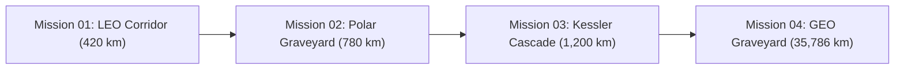

# ORBITAL CLEANUP: MISSION ZERO
## Official Commander's Flight Operations Manual & Player Guide

---

## 1. MISSION BRIEFING & BACKGROUND
Earth’s orbital environment has reached a critical density threshold known as the **Kessler Syndrome**—a catastrophic cascade where orbital collisions spawn clouds of debris, leading to exponential impacts that threaten to render near-Earth space unusable for generations.

As a designated commander under the **Aegis Orbital Defense Initiative**, your task is to pilot an orbital sanitation craft into active debris corridors. You will collect derelict hardware, dodge hypersonic kinetic threats, manage finite fuel and energy, and safely ferry scrap to the **Aegis Orbital Depot** for recycling into mission credits and spacecraft retrofits.

---

## 2. PILOT CONTROLS & FLIGHT DYNAMICS

| Action | Primary Key | Secondary Key | Operational Details |
| :--- | :--- | :--- | :--- |
| **Main Thruster Propulsion** | `W` | `▲ Up Arrow` | Fires rear ion engines. Accelerates spacecraft in the current heading. Consumes fuel. |
| **RCS Yaw Steering** | `A` / `D` | `◄` / `►` | Fires lateral reaction control thrusters to rotate spacecraft heading. |
| **Retro-Thruster Braking** | `S` | `▼ Down Arrow` | Fires forward-facing counter-thrusters to shed orbital velocity and bring ship to a stop. |
| **Activate Equipment** | `SPACEBAR` | `SPACEBAR` | Fires Grapple Arm, deploys Capture Net, or sustains Magnetic Tractor Beam. |
| **Dock & Recycle** | `E` | Hold Position | Initiates docking sequence when inside Aegis Depot harbor perimeter. |
| **Mission Pause** | `P` | `ESC` | Halts flight simulation and reveals command options. |

> [!TIP]
> **Orbital Inertia:** Space is frictionless! Releasing the `W` key does not stop your vessel; you will continue to drift at constant velocity. Use gentle taps of `S` (retro-thrusters) or turn around and fire counter-burns to stabilize your drift.

---

## 3. MISSION DESIGN MODE (PRE-FLIGHT PREPARATION)
Before launching into orbit, every commander enters the **Mission Design Studio**. Combining the right ship, equipment, and payload balance for each mission sector is essential to success:

### A. Choose Your Spacecraft Airframe
* **Aero-Dart (Scout):**
  * *Attributes:* Top Speed (★★★★★), Agility (★★★★★), Cargo (★★☆☆☆), Hull Armor (★★☆☆☆)
  * *Profile:* Ultra-fast interceptor with 3 cargo slots. Ideal for rapid precision runs and darting out of hazard zones. Features enhanced passive solar recharge rates.
* **Orbital Mule (Collector):**
  * *Attributes:* Top Speed (★★★☆☆), Agility (★★★☆☆), Cargo (★★★★☆), Hull Armor (★★★☆☆)
  * *Profile:* Multi-purpose industrial workhorse with 5 cargo slots. Well-balanced fuel capacity, armor, and battery pools.
* **Titan Hauler (Heavy Lifter):**
  * *Attributes:* Top Speed (★★☆☆☆), Agility (★★☆☆☆), Cargo (★★★★★), Hull Armor (★★★★★)
  * *Profile:* Armored catamaran platform carrying 8 cargo slots and heavy structural shielding. Slower acceleration, but capable of hauling massive debris yields in single runs.

### B. Select Retrieval Equipment
* **Robotic Grapple Arm:**
  * Fires a high-tensile clamp directly forward to reel in designated targets one at a time.
  * *Advantage:* Lowest battery consumption (10 per shot) and grants an innate **+35% Scrap Value Bonus** on retrieved debris.
* **Wide-Angle Capture Net:**
  * Launches an expanding electromagnetic energy mesh that grows up to 120m across.
  * *Advantage:* Captures all small and medium debris fragments within its blast radius simultaneously. Ideal for dense fragment swarms.
* **Magnetic Tractor Beam:**
  * Hold `SPACEBAR` to emit a wide, continuous 70° graviton cone forward.
  * *Advantage:* Continuously draws nearby metallic debris towards your intake hold. Drains battery continuously while held.

### C. Mission Subsystem & Payload Tuning
* **Standard Mission Balance:** Factory-balanced performance across all systems.
* **Extended Fuel Tank:** +40% Fuel pool, -10% Cruising speed. Recommended for large sectors.
* **Auxiliary Supercapacitor:** +40% Battery capacity, +25% Solar recharge velocity. Ideal for sustained tractor beam or net use.
* **Nanotube Reinforced Plating:** +40% Maximum Hull Integrity, -15% Handling. Crucial for high-hazard collision belts.

---

## 4. ORBITAL SECTORS & PROGRESSION

1. **Mission 01: Low Earth Orbit (LEO) - ISS Corridor (Alt: 420 km)**
   * *Target Quota:* 8 Debris Units | *Time Window:* 150 seconds
   * *Environment:* Fragment clouds and broken solar panels threatening human spaceflight lanes. Mild hazard density.
2. **Mission 02: Sun-Synchronous Polar Orbit (Alt: 780 km)**
   * *Target Quota:* 14 Debris Units | *Time Window:* 180 seconds
   * *Environment:* Shattered weather satellites and tumbling solar arrays. Introduces volatile hypergolic fuel tanks.
3. **Mission 03: Kessler Cascade Zone (Alt: 1,200 km)**
   * *Target Quota:* 20 Debris Units | *Time Window:* 210 seconds
   * *Environment:* Ongoing chain-reaction collisions. Dense shrapnel, unguided booster tanks, and toxic hypergolic gas clouds.
4. **Mission 04: Geostationary Graveyard - Operation Cleanse (Alt: 35,786 km)**
   * *Target Quota:* 25 Debris Units | *Time Window:* 240 seconds
   * *Environment:* High-orbit graveyard containing massive communications arrays, leaking nuclear RTG cores, and high-velocity kinetic projectiles.

---

## 5. RESOURCE MANAGEMENT & HUD TELEMETRY

Your in-flight HUD provides real-time readouts of spacecraft health and environmental conditions:

* **Fuel Gauge:** Movement burns propellant. Coasting on inertia preserves fuel. If fuel drops to zero far from the station, the ship drifts disabled, failing the mission.
* **Battery Gauge:** Using equipment consumes power. When inactive, solar panels passively recharge the battery (unless disrupted by radioactive fields).
* **Hull Integrity:** Displays structural strength. Collisions with debris cause minor hull scuffs; impacts with explosive hazards or kinetic meteorites cause critical damage. A red breach warning flashes below 30%.
* **Cargo Hold:** Visual indicator slots showing current load vs. capacity. When full, additional debris cannot be collected until delivered to the station.
* **Collision Radar & Hazard Warning:**
  * When high-speed obstacles approach within 380m, an urgent audio alarm pulses, and the HUD flashes:  
    `⚠️ COLLISION WARNING - EVASIVE ACTION REQUIRED ⚠️`
  * Red directional indicators point toward off-screen incoming threats.
  * Green directional indicators point toward the **Aegis Station Depot**.

---

## 6. DEBRIS CATALOG & VALUE BREAKDOWN

| Debris Classification | Mass | Base Score | Base Scrap | Tactical Notes |
| :--- | :--- | :--- | :--- | :--- |
| **Structural Bolt & Shards** | 15 kg | 120 pts | 15 Scrap | Common, fast-drifting metallic shrapnel. |
| **Broken Solar Array** | 45 kg | 250 pts | 35 Scrap | Fragile photovoltaic panels rich in rare earth metals. |
| **Research Cubesat** | 75 kg | 420 pts | 60 Scrap | Miniature scientific chassis with intact avionics. |
| **Spent Rocket Booster** | 220 kg | 750 pts | 110 Scrap | Bulky titanium fuel cylinder with high scrap yield. |
| **Derelict Comms Satellite** | 380 kg | 1,200 pts | 180 Scrap | High-value orbiter with antenna reflectors. |
| **Prototype Fusion Core** | 160 kg | 2,000 pts | 300 Scrap | Rare experimental module with cryogenic capacitors. |

---

## 7. ORBITAL HAZARDS & THREAT MITIGATION

* **Kinetic Micrometeoroids:** Jagged hypersonic space rocks streaking across orbital trajectories. Deal severe collision damage. Use retro-burns or lateral maneuvers to evade.
* **Volatile Hydrazine Mines:** Pressurized fuel containers marked with hazard icons. Explode on impact, inflicting heavy hull damage.
* **RTG Nuclear Satellites:** Derelict probes emitting a glowing green radiation sphere. Flying within range continuously drains battery reserves and halts solar recharge.

---

## 8. AEGIS ORBITAL DEPOT DOCKING & RECYCLING

The central space station serves as your mission hub:
1. When your cargo hold is full (or when damaged/low on fuel), navigate toward the **Aegis Depot** in the center of the sector.
2. Enter the glowing green docking perimeter ring.
3. Bring your ship to a stop or press `E`.
4. The station's tractor harbor locks your craft, unloads all collected debris, refuels your tanks to 100%, recharges your battery, and repairs all hull damage!
5. Once your delivered debris count satisfies the mission target quota, the mission completes successfully.

---

## 9. HANGAR WORKSHOP & SHIP UPGRADES
Scrap credits earned across all missions persist permanently in **LocalStorage**. Visit the Hangar Workshop to upgrade your fleet:

* **Ion-Thruster Efficiency (Tiers 1–5):** Reduces fuel consumption rate by 12% and boosts top cruising speed by 8% per level.
* **Nanotube Armor Weave (Tiers 1–5):** Increases spacecraft maximum hull integrity by 20% and reduces impact collision damage.
* **Photovoltaic Fusion Cell (Tiers 1–5):** Expands total battery pool by 20% and increases solar recharge rate.
* **Cargo Bay Compression Field (Tiers 1–4):** Adds +1 permanent cargo slot to all spacecraft airframes.
* **Deep-Space Telemetry Radar (Tiers 1–5):** Extends hazard detection range and enhances magnetic tractor suction radius by 15% per tier.

---

## 10. SCORING & MISSION RATINGS
Upon mission completion, your performance is rated on a 1 to 3 Star scale based on:
$$\text{Final Score} = \text{Recycled Value} + (\text{Time Remaining} \times 15) + \left(\frac{\text{Hull Remaining}}{\text{Max Hull}} \times 500\right)$$
Achieving higher star tiers unlocks prestigious entries on the **Local Top Runs** leaderboard!

